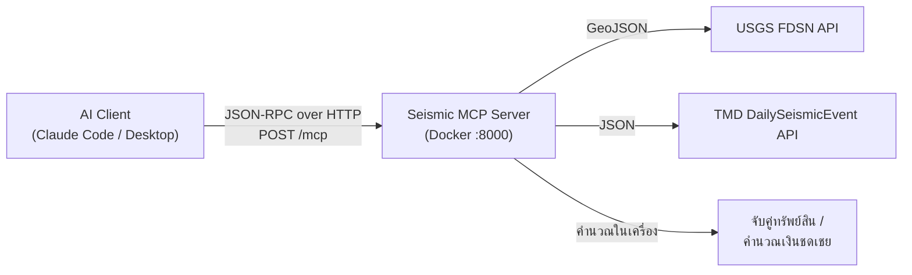

# Seismic MCP Server

MCP (Model Context Protocol) Server สำหรับ **ดึงข้อมูลแผ่นดินไหว** และ **วิเคราะห์ประกันภัยแบบ Parametric**
ให้ AI (เช่น Claude) เรียกใช้เป็นเครื่องมือได้โดยตรง ทำงานผ่าน **Streamable HTTP** และรันบน **Docker**

> ตัวอย่างสิ่งที่ถามได้หลังเชื่อมต่อ:
> - "ขอแผ่นดินไหวขนาด 5 ขึ้นไปทั่วโลกในสัปดาห์นี้จาก USGS"
> - "3 วันล่าสุดมีแผ่นดินไหวที่ TMD รายงานบ้าง และมีอันไหนอยู่ใกล้โกดังเราที่เชียงใหม่ไหม"
> - "ถ้าเกิดแผ่นดินไหวครั้งนี้ ต้องจ่ายเงินประกันให้ทรัพย์สินแต่ละแห่งเท่าไร"

---

## สารบัญ

1. [ภาพรวม](#1-ภาพรวม)
2. [โครงสร้างโปรเจกต์](#2-โครงสร้างโปรเจกต์)
3. [เริ่มต้นใช้งานด้วย Docker](#3-เริ่มต้นใช้งานด้วย-docker)
4. [เชื่อมต่อกับ Client](#4-เชื่อมต่อกับ-client)
5. [เครื่องมือ (Tools) ทั้งหมด](#5-เครื่องมือ-tools-ทั้งหมด)
6. [รูปแบบข้อมูล EarthquakeEvent](#6-รูปแบบข้อมูล-earthquakeevent)
7. [ทดลองเรียกด้วย curl](#7-ทดลองเรียกด้วย-curl)
8. [รายละเอียด Transport](#8-รายละเอียด-transport)
9. [Error Codes](#9-error-codes)
10. [ตัวแปรสภาพแวดล้อม](#10-ตัวแปรสภาพแวดล้อม-environment-variables)
11. [ข้อสังเกตเกี่ยวกับ API ของ TMD](#11-ข้อสังเกตเกี่ยวกับ-api-ของ-tmd)
12. [รันโดยไม่ใช้ Docker](#12-รันโดยไม่ใช้-docker)
13. [แก้ปัญหาที่พบบ่อย](#13-แก้ปัญหาที่พบบ่อย)

---

## 1. ภาพรวม

### MCP คืออะไร

MCP เป็นมาตรฐานที่ให้แอป AI (Claude Desktop, Claude Code, Cursor ฯลฯ) ค้นหาและเรียกใช้ "เครื่องมือ" จากโปรแกรมภายนอกได้
โดยคุยกันด้วย **JSON-RPC 2.0** โดย Server นี้รองรับ 3 คำสั่งหลักของ MCP:

| Method | หน้าที่ |
|---|---|
| `initialize` | เริ่มการเชื่อมต่อ ตกลงเวอร์ชันโปรโตคอล และบอกชื่อ/ความสามารถของ Server |
| `tools/list` | ส่งรายชื่อเครื่องมือพร้อม input schema ให้ AI รู้ว่าเรียกอะไรได้บ้าง |
| `tools/call` | เรียกใช้เครื่องมือตามชื่อและอาร์กิวเมนต์ แล้วส่งผลลัพธ์กลับ |

(รองรับ `ping` และ `notifications/initialized` ด้วย)

### การทำงาน



1. **ดึงข้อมูล**: เรียก API ของ USGS (ทั่วโลก) หรือกรมอุตุนิยมวิทยา TMD (ภูมิภาคไทย)
2. **แปลงรูปแบบ**: ข้อมูลจากทั้งสองแหล่งถูกแปลงเป็นรูปแบบเดียวกัน คือ [`EarthquakeEvent`](#6-รูปแบบข้อมูล-earthquakeevent)
3. **วิเคราะห์**: นำเหตุการณ์ไปจับคู่กับทรัพย์สินที่ทำประกัน และคำนวณเงินชดเชยตามเงื่อนไข (trigger)

### Data Sources

| แหล่ง | URL | การยืนยันตัวตน |
|---|---|---|
| USGS Earthquake FDSN | `https://earthquake.usgs.gov/fdsnws/event/1/query` | ไม่ต้อง |
| TMD DailySeismicEvent (demo) | `https://data.tmd.go.th/api/DailySeismicEvent/v1/` | ใช้ demo key `uid=api`, `ukey=api12345` (ฝังในโค้ดแล้ว) |

---

## 2. โครงสร้างโปรเจกต์

```
.
├── seismic_mcp_server.py   # ตัว Server ทั้งหมด (tools, JSON-RPC, HTTP/stdio transport)
├── requirements.txt        # Python dependencies (httpx, jsonschema, starlette, uvicorn, tzdata)
├── Dockerfile              # สร้าง image (python:3.12-slim, รันเป็น non-root, มี healthcheck)
├── docker-compose.yml      # สั่งรันด้วยคำสั่งเดียว เปิดพอร์ต 127.0.0.1:8000
├── .dockerignore
├── .mcp.json               # ไฟล์ตั้งค่าให้ Claude Code เชื่อมต่อ Server นี้อัตโนมัติ
├── test_client.py          # สคริปต์ทดสอบทุก tool (ใช้แค่ standard library)
└── README.md
```

ภายใน `seismic_mcp_server.py` แบ่งเป็นส่วนๆ ตามลำดับ:

| ส่วน | หน้าที่ |
|---|---|
| HTTP helpers | เรียก API ภายนอกด้วย `httpx` พร้อม cache 60 วินาที |
| Normalisation | แปลงข้อมูล USGS / TMD เป็น `EarthquakeEvent` |
| Geo helpers | คำนวณระยะทางด้วยสูตร Haversine |
| Tool implementations | logic ของทั้ง 5 tools |
| Tool registry | ชื่อ, คำอธิบาย, `inputSchema` ของแต่ละ tool |
| Dispatcher | ตรวจ JSON-RPC, validate อาร์กิวเมนต์ด้วย JSON Schema, เรียก tool |
| Transports | Streamable HTTP (Starlette + Uvicorn) และ stdio |

---

## 3. เริ่มต้นใช้งานด้วย Docker

### สิ่งที่ต้องมี

- [Docker Desktop](https://www.docker.com/products/docker-desktop/) (มี `docker compose` ในตัว)
- เครื่องต้องออกอินเทอร์เน็ตได้ (เพื่อเรียก USGS และ TMD)

### ขั้นที่ 1: Clone และเข้าโฟลเดอร์

```bash
git clone https://github.com/benzjannapa/seismic-mcp-server.git && cd seismic-mcp-server
```

### ขั้นที่ 2: Build และรัน container

```bash
docker compose up -d --build
```

- `--build` สร้าง image ใหม่จาก `Dockerfile` (ครั้งแรกใช้เวลาประมาณ 1 นาที)
- `-d` รันอยู่เบื้องหลัง
- container ชื่อ `seismic-mcp` จะเปิดที่ `http://localhost:8000` และเริ่มใหม่เองถ้าล่ม (`restart: unless-stopped`)

### ขั้นที่ 3: ตรวจว่าทำงานแล้ว

```bash
curl http://localhost:8000/health
```

ผลที่ควรได้:

```json
{"status":"ok","server":"seismic-mcp-server","version":"0.1.0","tools":["usgs_search_earthquakes","tmd_get_daily_earthquakes","tmd_get_recent_earthquakes","match_events_to_assets","compute_parametric_payout"],"sessions":0}
```

ดูสถานะ healthcheck ของ Docker (ควรเป็น `healthy`):

```bash
docker inspect --format '{{.State.Health.Status}}' seismic-mcp
```

### ขั้นที่ 4: ทดสอบทุก tool

```bash
python3 test_client.py http://localhost:8000/mcp
```

สคริปต์จะ `initialize` → `tools/list` → เรียกทั้ง 5 tools → ทดสอบกรณี error ตัวอย่างผลลัพธ์:

```
initialize: {'name': 'seismic-mcp-server', 'version': '0.1.0'}
tools: ['usgs_search_earthquakes', 'tmd_get_daily_earthquakes', ...]
usgs_search_earthquakes: 5 events; first = {'id': 'us7000s2nv', 'magnitude': 4.8, ...}
tmd_get_recent_earthquakes 3d: 18 events; ...
compute_parametric_payout: [('A-001', 3.35, 500000.0), ('A-002', 77.34, 500000.0), ('A-003', 583.42, 0.0)] total = 1000000.0
validation error test:
  usgs_search_earthquakes: ERROR -32602 Invalid arguments ...: 'endtime' is a required property
```

(จำนวนเหตุการณ์จาก TMD จะต่างกันไปตามวันที่รัน)

### คำสั่งที่ใช้บ่อย

| ต้องการ | คำสั่ง |
|---|---|
| ดู log | `docker compose logs -f` |
| หยุด | `docker compose down` |
| รันใหม่หลังแก้โค้ด | `docker compose up -d --build` |
| รันด้วย `docker` เปล่าๆ (ไม่ใช้ compose) | `docker build -t seismic-mcp-server . && docker run --rm -p 127.0.0.1:8000:8000 seismic-mcp-server` |

> **หมายเหตุด้านความปลอดภัย:** `docker-compose.yml` ผูกพอร์ตไว้ที่ `127.0.0.1` คือเข้าได้จากเครื่องตัวเองเท่านั้น
> ถ้าต้องการให้เครื่องอื่นในเครือข่ายเข้าได้ ให้เปลี่ยนเป็น `"8000:8000"` (Server ไม่มีระบบ login จึงควรเปิดเฉพาะในเครือข่ายที่ไว้ใจได้)

---

## 4. เชื่อมต่อกับ Client

ทุก client ต้องให้ container รันอยู่ก่อน (`docker compose up -d`) และใช้ URL เดียวกันคือ **`http://localhost:8000/mcp`**

### Claude Code

**วิธีที่ 1: ใช้ไฟล์ `.mcp.json` ที่มีอยู่แล้ว (แนะนำ)**
เปิด Claude Code ในโฟลเดอร์โปรเจกต์นี้ จะมีคำถามให้อนุญาต server `seismic-mcp` ให้กดอนุญาต แล้วเริ่ม session ใหม่

```json
{
  "mcpServers": {
    "seismic-mcp": { "type": "http", "url": "http://localhost:8000/mcp" }
  }
}
```

**วิธีที่ 2: ใช้คำสั่ง CLI** (ใช้ได้ทุกโฟลเดอร์ ถ้าใส่ `--scope user`)

```bash
claude mcp add --transport http --scope user seismic-mcp http://localhost:8000/mcp
```

ตรวจสอบ: พิมพ์ `/mcp` ใน Claude Code ควรเห็น `seismic-mcp` สถานะ connected และมี 5 tools

### Claude Desktop

Claude Desktop เชื่อมผ่าน stdio จึงต้องใช้ตัวกลาง [`mcp-remote`](https://www.npmjs.com/package/mcp-remote) (ต้องมี Node.js)
แก้ไฟล์ `claude_desktop_config.json` (Settings → Developer → Edit Config):

```json
{
  "mcpServers": {
    "seismic-mcp": {
      "command": "npx",
      "args": ["-y", "mcp-remote", "http://localhost:8000/mcp"]
    }
  }
}
```

แล้วปิด-เปิด Claude Desktop ใหม่

### Cursor / VS Code / client อื่นที่รองรับ HTTP

```json
{ "mcpServers": { "seismic-mcp": { "type": "http", "url": "http://localhost:8000/mcp" } } }
```

### MCP Inspector (สำหรับ debug)

```bash
npx @modelcontextprotocol/inspector
```

เลือก Transport = **Streamable HTTP**, URL = `http://localhost:8000/mcp` แล้วกด Connect จะลองเรียกแต่ละ tool ผ่านหน้าเว็บได้

---

## 5. เครื่องมือ (Tools) ทั้งหมด

| Tool | ประเภท | หน้าที่โดยสรุป |
|---|---|---|
| [`usgs_search_earthquakes`](#51-usgs_search_earthquakes) | ดึงข้อมูล | ค้นหาแผ่นดินไหวทั่วโลกจาก USGS ตามช่วงเวลา/ขนาด/พื้นที่ |
| [`tmd_get_daily_earthquakes`](#52-tmd_get_daily_earthquakes) | ดึงข้อมูล | แผ่นดินไหวของวันที่ระบุจาก TMD |
| [`tmd_get_recent_earthquakes`](#53-tmd_get_recent_earthquakes) | ดึงข้อมูล | แผ่นดินไหวย้อนหลัง N วันจาก TMD |
| [`match_events_to_assets`](#54-match_events_to_assets) | วิเคราะห์ | หาว่าทรัพย์สินใดอยู่ในรัศมีของแผ่นดินไหว |
| [`compute_parametric_payout`](#55-compute_parametric_payout) | วิเคราะห์ | คำนวณเงินชดเชยประกันแบบ parametric |

**ลำดับการใช้งานทั่วไป:** ดึงเหตุการณ์ด้วย tool กลุ่ม `usgs_*` / `tmd_*` → ส่ง `events` ที่ได้ต่อให้ `match_events_to_assets` หรือ `compute_parametric_payout`
(AI จะทำขั้นตอนนี้ให้เองเมื่อถามเป็นภาษาธรรมชาติ)

ทุก tool ตรวจอาร์กิวเมนต์ตาม JSON Schema ก่อนทำงาน ถ้าผิด (ขาด field ที่จำเป็น, ชนิดผิด, เกินช่วง, มี field ที่ไม่รู้จัก) จะได้ error `-32602`
ค่าที่ไม่ส่งมาจะใช้ค่า default ตามตาราง

---

### 5.1 `usgs_search_earthquakes`

ค้นหาแผ่นดินไหวจาก USGS FDSN API

| พารามิเตอร์ | ชนิด | จำเป็น | Default | คำอธิบาย |
|---|---|---|---|---|
| `starttime` | string | ✅ | – | วันเริ่มต้น `YYYY-MM-DD` หรือ ISO8601 |
| `endtime` | string | ✅ | – | วันสิ้นสุด `YYYY-MM-DD` หรือ ISO8601 |
| `minmagnitude` | number | | `4.5` | ขนาดต่ำสุด |
| `maxmagnitude` | number | | – | ขนาดสูงสุด (ต้อง ≥ `minmagnitude`) |
| `latitude` | number | | – | ละติจูดจุดศูนย์กลาง (-90 ถึง 90) |
| `longitude` | number | | – | ลองจิจูดจุดศูนย์กลาง (-180 ถึง 180) |
| `maxradiuskm` | number | | – | รัศมีค้นหา (กม.) |
| `limit` | integer | | `20` | จำนวนสูงสุด 1–200 |

> ค้นหาตามพื้นที่ต้องส่ง `latitude`, `longitude`, `maxradiuskm` **ครบทั้ง 3 ตัว**

**ตัวอย่าง input:** แผ่นดินไหว M≥5 ในรัศมี 1,000 กม. จากกรุงเทพฯ

```json
{
  "starttime": "2026-10-01",
  "endtime": "2026-11-07",
  "minmagnitude": 5,
  "latitude": 13.75,
  "longitude": 100.5,
  "maxradiuskm": 1000,
  "limit": 10
}
```

**Output:** เรียงจากใหม่ไปเก่า

```json
{
  "events": [ { "id": "us7000...", "time": "2026-...Z", "place": "...", "magnitude": 5.2, "...": "..." } ],
  "query": { "format": "geojson", "orderby": "time", "starttime": "2026-10-01", "...": "..." }
}
```

---

### 5.2 `tmd_get_daily_earthquakes`

ดึงแผ่นดินไหวของวันเดียวจากกรมอุตุนิยมวิทยา

| พารามิเตอร์ | ชนิด | จำเป็น | Default | คำอธิบาย |
|---|---|---|---|---|
| `date` | string | | วันนี้ (เวลาไทย) | `YYYY-MM-DD` |

**ตัวอย่าง input:** `{ "date": "2026-11-07" }` หรือ `{}` สำหรับวันนี้

**Output:**

```json
{
  "events": [
    {
      "id": "TMD-c06290ddf8bb",
      "time": "2026-11-07T13:11:20+00:00",
      "place": "ประเทศเมียนมา (Myanmar)",
      "magnitude": 2.1,
      "latitude": 19.694,
      "longitude": 97.683,
      "depth_km": 2.0,
      "source": "TMD_DailySeismicEvent",
      "url": null,
      "raw": { "OriginThai": "...", "DateTimeUTC": "2026-11-07 13:11:20.000", "...": "..." }
    }
  ],
  "query": { "date": "2026-11-07" }
}
```

"วัน" นับตามเวลาประเทศไทย (UTC+7) ดู [ข้อ 11](#11-ข้อสังเกตเกี่ยวกับ-api-ของ-tmd)

---

### 5.3 `tmd_get_recent_earthquakes`

รวมแผ่นดินไหวย้อนหลังหลายวันจาก TMD ตัดรายการซ้ำ และเรียงจากใหม่ไปเก่า

| พารามิเตอร์ | ชนิด | จำเป็น | Default | คำอธิบาย |
|---|---|---|---|---|
| `days` | integer | | `3` | จำนวนวันย้อนหลังนับรวมวันนี้ (1–7) |

**ตัวอย่าง input:** `{ "days": 3 }`

**Output:**

```json
{
  "events": [ "...EarthquakeEvent..." ],
  "query": { "days": 3, "dates": ["2026-11-07", "2026-11-06", "2026-11-05"] }
}
```

---

### 5.4 `match_events_to_assets`

หาว่าทรัพย์สินที่ทำประกันแต่ละแห่ง **อยู่ใกล้แผ่นดินไหวครั้งใดบ้าง**

| พารามิเตอร์ | ชนิด | จำเป็น | Default | คำอธิบาย |
|---|---|---|---|---|
| `events` | array | ✅ | – | รายการ `EarthquakeEvent` (ต้องมี `magnitude`, `latitude`, `longitude`) |
| `assets` | array | ✅ | – | ทรัพย์สิน: `asset_id`, `latitude`, `longitude` (จำเป็น), `name`, `sum_insured` (ไม่บังคับ) |
| `max_distance_km` | number | | `100` | ระยะห่างสูงสุดที่ถือว่า "ได้รับผลกระทบ" |
| `min_magnitude` | number | | `4.5` | ขนาดต่ำสุดที่นำมาพิจารณา |

**วิธีคิด**

1. ตัดเหตุการณ์ที่ `magnitude < min_magnitude` ออก (รวมถึงที่ไม่มีค่า magnitude)
2. คำนวณระยะทางจากจุดศูนย์กลางแผ่นดินไหวถึงทรัพย์สินแต่ละแห่งด้วยสูตร **Haversine** (ระยะบนผิวโลก หน่วย กม.)
3. ถ้าระยะ ≤ `max_distance_km` ถือว่าตรงกัน (match)
4. ส่งกลับเฉพาะทรัพย์สินที่มี match อย่างน้อย 1 ครั้ง โดยเรียงเหตุการณ์จากใกล้ไปไกล

**ตัวอย่าง input:**

```json
{
  "events": [ { "id": "TEST-1", "magnitude": 5.7, "latitude": 18.79, "longitude": 98.98 } ],
  "assets": [
    { "asset_id": "A-001", "name": "Warehouse Chiang Mai", "latitude": 18.80, "longitude": 98.95, "sum_insured": 1000000 },
    { "asset_id": "A-002", "name": "Factory Lampang",      "latitude": 18.29, "longitude": 99.49, "sum_insured": 2000000 },
    { "asset_id": "A-003", "name": "Office Bangkok",       "latitude": 13.75, "longitude": 100.50, "sum_insured": 5000000 }
  ]
}
```

**Output:** A-003 (กรุงเทพฯ, ห่าง ~583 กม.) ไม่อยู่ในผลลัพธ์

```json
{
  "matches": [
    { "asset_id": "A-001", "name": "Warehouse Chiang Mai", "sum_insured": 1000000,
      "events": [ { "event": { "id": "TEST-1", "...": "..." }, "distance_km": 3.35 } ] },
    { "asset_id": "A-002", "name": "Factory Lampang", "sum_insured": 2000000,
      "events": [ { "event": { "id": "TEST-1", "...": "..." }, "distance_km": 77.34 } ] }
  ],
  "parameters": { "max_distance_km": 100, "min_magnitude": 4.5 },
  "summary": { "events_considered": 1, "assets_total": 3, "assets_matched": 2 }
}
```

---

### 5.5 `compute_parametric_payout`

คำนวณเงินชดเชยประกันแบบ **Parametric** คือจ่ายตามเงื่อนไขที่วัดได้ (ขนาดและระยะทางของแผ่นดินไหว)
โดยไม่ต้องรอประเมินความเสียหายจริง

| พารามิเตอร์ | ชนิด | จำเป็น | Default | คำอธิบาย |
|---|---|---|---|---|
| `event` | object | ✅ | – | `EarthquakeEvent` 1 รายการ |
| `assets` | array | ✅ | – | ทรัพย์สิน: `asset_id`, `latitude`, `longitude`, `sum_insured` (จำเป็นทั้งหมด) |
| `min_magnitude_trigger` | number | | `5.0` | ขนาดต่ำสุดที่จะเริ่มจ่าย |
| `max_distance_km_trigger` | number | | `200` | ระยะสูงสุดที่มีสิทธิ์ได้รับเงิน |
| `payout_curve` | array | | ดูด้านล่าง | ขั้นการจ่ายตามระยะทาง `[{max_distance_km, payout_percent}]` |

**Payout curve เริ่มต้น**

| ระยะจากจุดศูนย์กลาง | จ่าย (% ของทุนประกัน) |
|---|---|
| ≤ 50 กม. | 50% |
| ≤ 100 กม. | 25% |
| ≤ 200 กม. | 10% |
| > 200 กม. | 0% |

**วิธีคิด**

```
ถ้า magnitude < min_magnitude_trigger  →  ทุกแห่งได้ 0 (triggered = false)
ไม่เช่นนั้น สำหรับทรัพย์สินแต่ละแห่ง:
    distance = haversine(จุดศูนย์กลาง, ทรัพย์สิน)
    ถ้า distance > max_distance_km_trigger  →  0
    ไม่เช่นนั้น  →  หาขั้นแรกใน payout_curve ที่ distance ≤ max_distance_km
                   payout_amount = sum_insured × payout_percent
total_payout = ผลรวมของทุกแห่ง
```

- `payout_curve` จะถูก **เรียงตาม `max_distance_km` จากน้อยไปมาก** ก่อนใช้ จึงส่งมาในลำดับใดก็ได้
- `payout_percent` เป็นสัดส่วน **0.0–1.0** (เช่น 0.25 = 25%) ถ้าอยู่นอกช่วงจะได้ error `-32602`

**ตัวอย่าง:** ใช้ event และ assets ชุดเดียวกับข้อ 5.4 (M5.7 ใกล้เชียงใหม่) และค่า default ทั้งหมด

| Asset | ระยะทาง | ขั้นที่เข้า | ทุนประกัน | เงินชดเชย |
|---|---|---|---|---|
| A-001 Warehouse Chiang Mai | 3.35 กม. | ≤ 50 กม. → 50% | 1,000,000 | **500,000** |
| A-002 Factory Lampang | 77.34 กม. | ≤ 100 กม. → 25% | 2,000,000 | **500,000** |
| A-003 Office Bangkok | 583.42 กม. | เกิน 200 กม. | 5,000,000 | **0** |
| | | | **รวม** | **1,000,000** |

**Output:**

```json
{
  "event_id": "TEST-1",
  "event_magnitude": 5.7,
  "triggered": true,
  "parameters": {
    "min_magnitude_trigger": 5.0,
    "max_distance_km_trigger": 200,
    "payout_curve": [
      { "max_distance_km": 50, "payout_percent": 0.5 },
      { "max_distance_km": 100, "payout_percent": 0.25 },
      { "max_distance_km": 200, "payout_percent": 0.1 }
    ]
  },
  "asset_payouts": [
    { "asset_id": "A-001", "name": "Warehouse Chiang Mai", "distance_km": 3.35, "sum_insured": 1000000, "payout_percent": 0.5, "payout_amount": 500000.0 },
    { "asset_id": "A-002", "name": "Factory Lampang", "distance_km": 77.34, "sum_insured": 2000000, "payout_percent": 0.25, "payout_amount": 500000.0 },
    { "asset_id": "A-003", "name": "Office Bangkok", "distance_km": 583.42, "sum_insured": 5000000, "payout_percent": 0.0, "payout_amount": 0.0 }
  ],
  "total_payout": 1000000.0
}
```

ถ้าเปลี่ยนเป็นแผ่นดินไหว M4.8 (ต่ำกว่า trigger 5.0) จะได้ `"triggered": false` และ `total_payout` = 0

---

## 6. รูปแบบข้อมูล EarthquakeEvent

ทุก tool ที่ส่งแผ่นดินไหวกลับมาใช้รูปแบบนี้ ไม่ว่าข้อมูลมาจากแหล่งไหน

| Field | ชนิด | คำอธิบาย | มาจาก USGS | มาจาก TMD |
|---|---|---|---|---|
| `id` | string | รหัสเหตุการณ์ | `feature.id` | `"TMD-" + EventID` (หรือ hash ถ้าไม่มี) |
| `time` | string | เวลา ISO8601 | `properties.time` (epoch ms → UTC) | `DateTimeUTC` หรือ `DateTime` |
| `place` | string | สถานที่ | `properties.place` | `Location` หรือ `OriginThai` |
| `magnitude` | number | ขนาด | `properties.mag` | `Magnitude` |
| `latitude` | number | ละติจูด | `geometry.coordinates[1]` | `Latitude` |
| `longitude` | number | ลองจิจูด | `geometry.coordinates[0]` | `Longitude` |
| `depth_km` | number | ความลึก (กม.) | `geometry.coordinates[2]` | `DepthKm` หรือ `Depth` |
| `source` | string | แหล่งข้อมูล | `"USGS"` | `"TMD_DailySeismicEvent"` |
| `url` | string \| null | ลิงก์รายละเอียด | `properties.url` | `null` |
| `raw` | object | ข้อมูลดิบจากผู้ให้บริการ | ทั้ง feature | ทั้ง item |

ค่าตัวเลขที่ API ส่งมาเป็น string (เช่น TMD ส่ง `"2.1"`) จะถูกแปลงเป็น number ให้อัตโนมัติ

---

## 7. ทดลองเรียกด้วย curl

ใช้เพื่อดูว่าข้างในคุยกันอย่างไร (client จริงทำให้อัตโนมัติ)

**1) initialize:** ดู header `Mcp-Session-Id` ที่ตอบกลับ (`-i` แสดง header)

```bash
curl -i -X POST http://localhost:8000/mcp -H 'Content-Type: application/json' -H 'Accept: application/json, text/event-stream' -d '{"jsonrpc":"2.0","id":1,"method":"initialize","params":{"protocolVersion":"2025-06-18","capabilities":{},"clientInfo":{"name":"curl","version":"1"}}}'
```

**2) tools/list**

```bash
curl -s -X POST http://localhost:8000/mcp -H 'Content-Type: application/json' -H 'Accept: application/json, text/event-stream' -d '{"jsonrpc":"2.0","id":2,"method":"tools/list"}'
```

**3) tools/call:** แผ่นดินไหววันนี้จาก TMD

```bash
curl -s -X POST http://localhost:8000/mcp -H 'Content-Type: application/json' -H 'Accept: application/json, text/event-stream' -d '{"jsonrpc":"2.0","id":3,"method":"tools/call","params":{"name":"tmd_get_daily_earthquakes","arguments":{}}}'
```

ผลลัพธ์ของ `tools/call` อยู่ในรูปแบบมาตรฐาน MCP:

```json
{
  "jsonrpc": "2.0",
  "id": 3,
  "result": {
    "content": [ { "type": "text", "text": "{\"events\": [...], \"query\": {...}}" } ],
    "structuredContent": { "events": [ "..." ], "query": { "date": "2026-11-07" } },
    "isError": false
  }
}
```

- `structuredContent`: ผลลัพธ์เป็น object ตาม spec (สำหรับโปรแกรม)
- `content[0].text`: ข้อมูลเดียวกันแบบ JSON string (สำหรับ client ที่อ่านได้แค่ข้อความ)

---

## 8. รายละเอียด Transport

### Streamable HTTP (ค่าเริ่มต้น)

ใช้ endpoint เดียวคือ `/mcp`

| Method | Path | พฤติกรรม |
|---|---|---|
| `POST` | `/mcp` | รับ JSON-RPC 1 ข้อความหรือเป็น batch (array) ถ้าเป็น request ตอบ `200` แบบ `application/json` (หรือ SSE ถ้า client รับแค่ `text/event-stream`) ถ้าเป็น notification อย่างเดียวตอบ `202` |
| `GET` | `/mcp` | `405` เพราะ Server ไม่ส่งข้อความหา client เอง |
| `DELETE` | `/mcp` | ปิด session ตาม header `Mcp-Session-Id` |
| `GET` | `/health` | ตรวจสุขภาพ (ใช้กับ Docker healthcheck) |

**Session:** เมื่อ `initialize` สำเร็จ Server ส่ง header `Mcp-Session-Id` กลับมา client ควรแนบ header นี้ในทุก request ถัดไป
ถ้าส่ง session id ที่ไม่รู้จัก (เช่นหลัง container restart) จะได้ `404` และ client ต้อง `initialize` ใหม่
ค่าเริ่มต้นยอมรับ request ที่ไม่มี session id (ตั้ง `REQUIRE_SESSION=true` เพื่อบังคับ)

**ความปลอดภัย (Origin check):** ป้องกันการโจมตีแบบ DNS rebinding โดยตรวจ header `Origin`
ถ้าไม่มี Origin (เช่น CLI, curl) หรือเป็น localhost จะผ่าน ถ้าเป็นโดเมนอื่นจะได้ `403` เพิ่มได้ด้วย `ALLOWED_ORIGINS`

**เวอร์ชันโปรโตคอลที่รองรับ:** `2025-06-18`, `2025-03-26`, `2024-11-05` (ถ้า client ขอเวอร์ชันอื่นจะตอบ `2025-06-18`)

### stdio

สำหรับ client ที่รัน Server เป็น subprocess: อ่าน JSON-RPC จาก stdin บรรทัดละ 1 ข้อความ ตอบทาง stdout และเขียน log ทาง stderr เท่านั้น

```bash
python seismic_mcp_server.py --transport stdio
```

ตั้งค่าใน Claude Desktop แบบไม่ใช้ Docker:

```json
{
  "mcpServers": {
    "seismic-mcp": {
      "command": "python3",
      "args": ["/absolute/path/to/seismic_mcp_server.py", "--transport", "stdio"]
    }
  }
}
```

---

## 9. Error Codes

error จะส่งกลับในรูป JSON-RPC `error` เช่น

```json
{ "jsonrpc": "2.0", "id": 5, "error": { "code": -32602, "message": "Invalid arguments for usgs_search_earthquakes: 'endtime' is a required property", "data": { "errors": [ { "path": "(root)", "message": "'endtime' is a required property" } ] } } }
```

| Code | ความหมาย | ตัวอย่างสาเหตุ |
|---|---|---|
| `-32700` | Parse error | body ไม่ใช่ JSON |
| `-32600` | Invalid request | ไม่ใช่ JSON-RPC 2.0, session ไม่ถูกต้อง, Origin ไม่อนุญาต |
| `-32601` | Method not found | เรียก method ที่ไม่มี |
| `-32602` | Invalid params | อาร์กิวเมนต์ผิด schema, ชื่อ tool ผิด, `days` เกิน 7, ส่งพิกัดไม่ครบ |
| `-32603` | Internal error | ข้อผิดพลาดที่ไม่คาดคิดในโค้ด |
| `-32001` | Upstream HTTP error | USGS/TMD ล่ม, timeout, ตอบ HTTP 4xx/5xx |
| `-32002` | Upstream parse error | USGS/TMD ตอบกลับในรูปแบบที่อ่านไม่ได้ |

---

## 10. ตัวแปรสภาพแวดล้อม (Environment Variables)

ตั้งได้ใน `docker-compose.yml` ส่วน `environment:` หรือ `docker run -e KEY=value`

| ตัวแปร | ค่าเริ่มต้น | ความหมาย |
|---|---|---|
| `MCP_TRANSPORT` | `streamable-http` | `streamable-http` หรือ `stdio` |
| `HOST` | `0.0.0.0` (ใน container), `127.0.0.1` (นอก container) | address ที่ฟัง |
| `PORT` | `8000` | พอร์ต |
| `MCP_PATH` | `/mcp` | path ของ endpoint |
| `SERVER_TZ` | `Asia/Bangkok` | timezone สำหรับคำนวณ "วันนี้" |
| `ALLOWED_ORIGINS` | (ว่าง) | Origin ที่อนุญาตเพิ่ม คั่นด้วย comma เช่น `https://app.example.com` (`*` = ทั้งหมด) |
| `REQUIRE_SESSION` | `false` | `true` = ทุก request ต้องมี `Mcp-Session-Id` |
| `CACHE_TTL` | `60` | เวลาเก็บ cache ผลจาก API ภายนอก (วินาที) |
| `HTTP_TIMEOUT` | `30` | timeout การเรียก USGS/TMD (วินาที) |
| `LOG_LEVEL` | `info` | `debug`, `info`, `warning`, `error` |

---

## 11. ข้อสังเกตเกี่ยวกับ API ของ TMD

จากการทดสอบจริง API demo ของ TMD **ตอบกลับต่างจากที่ spec ระบุ** Server จึงรองรับทั้งสองแบบ

| เรื่อง | ตาม spec | ที่ API ตอบจริง | Server จัดการอย่างไร |
|---|---|---|---|
| ชื่อ array | `DailySeismicEvent` | `DailyEarthquakes` | อ่านได้ทั้งสองชื่อ |
| รหัสเหตุการณ์ | `EventID` | ไม่มี | สร้าง `TMD-<hash 12 ตัว>` จาก เวลา+พิกัด+ขนาด (ค่าเดิมทุกครั้ง จึงใช้ตัดรายการซ้ำได้) |
| เวลา | `DateTime` (มี timezone) | `DateTimeUTC`, `DateTimeThai` (ไม่มี timezone) | ใช้ `DateTimeUTC` แล้วแปลงเป็น ISO8601 UTC |
| ความลึก / สถานที่ | `DepthKm` / `Location` | `Depth` / `OriginThai` | อ่านได้ทั้งสองชื่อ |
| ตัวเลข | number | string เช่น `"4.1"` | แปลงเป็น number |
| พารามิเตอร์ `Date` | กรองตามวัน | **ไม่มีผล** ส่งข้อมูลย้อนหลังทั้งหมด (~1,400 รายการ) ทุกครั้ง | กรองตามวันเองโดยใช้วันตามเวลาไทย (UTC+7) |

ผลกระทบ: เรียก `tmd_get_recent_earthquakes` ครั้งแรกอาจใช้เวลาหลายวินาทีเพราะต้องโหลดข้อมูลทั้งหมด หลังจากนั้นภายใน 60 วินาทีจะใช้ cache

---

## 12. รันโดยไม่ใช้ Docker

ต้องมี Python 3.11 ขึ้นไป

```bash
python3 -m venv .venv && source .venv/bin/activate
```

```bash
pip install -r requirements.txt
```

```bash
python seismic_mcp_server.py
```

Server จะฟังที่ `http://127.0.0.1:8000/mcp` ตัวเลือกเพิ่มเติม:

```bash
python seismic_mcp_server.py --host 0.0.0.0 --port 9000 --path /mcp
```

---

## 13. แก้ปัญหาที่พบบ่อย

| อาการ | สาเหตุที่เป็นไปได้ | วิธีแก้ |
|---|---|---|
| `curl: (7) Failed to connect to localhost port 8000` | container ไม่ได้รัน | `docker compose up -d` แล้วดู `docker compose ps` |
| `port is already allocated` ตอน `up` | มีโปรแกรมอื่นใช้พอร์ต 8000 | เปลี่ยนใน compose เป็น `"127.0.0.1:8001:8000"` แล้วใช้ URL `:8001` |
| Claude Code ไม่เห็น tools | ยังไม่ได้อนุญาต server หรือยังไม่ได้เริ่ม session ใหม่ | เปิด session ใหม่ในโฟลเดอร์นี้, ตรวจด้วย `/mcp` |
| Client ได้ `404 Session not found` | container restart ทำให้ session เดิมหาย | reconnect (client ส่วนใหญ่ทำให้อัตโนมัติ) |
| ได้ `403 Origin not allowed` | เรียกจากหน้าเว็บโดเมนอื่น | เพิ่มโดเมนใน `ALLOWED_ORIGINS` |
| error `-32001` | USGS/TMD ล่มหรือเครือข่ายมีปัญหา | ลองใหม่ภายหลัง, เพิ่ม `HTTP_TIMEOUT` |
| TMD ได้ `events: []` | วันนั้นไม่มีเหตุการณ์ หรือวันที่เก่ากว่าข้อมูลที่ API มี | ลองวันล่าสุด หรือใช้ `tmd_get_recent_earthquakes` |
| "วันนี้" ไม่ตรงกับที่คาด | timezone | ตั้ง `SERVER_TZ` (ค่าเริ่มต้น `Asia/Bangkok`) |
| ดูรายละเอียด error | | `docker compose logs -f` หรือตั้ง `LOG_LEVEL=debug` |
