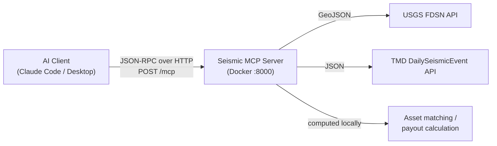

# Seismic MCP Server

**English**

An MCP (Model Context Protocol) server for **earthquake data** and **parametric insurance analytics**.
AI clients such as Claude can call it directly as a set of tools. It uses the **Streamable HTTP** transport and runs in **Docker**.

> Things you can ask once it's connected:
> - "Show me M5+ earthquakes worldwide this week from USGS."
> - "What earthquakes did TMD report in the last 3 days, and were any near our warehouse in Chiang Mai?"
> - "If this earthquake happened, how much would we pay out for each insured asset?"

---

### How it works



1. **Fetch**: call the USGS API (worldwide) or the Thai Meteorological Department (TMD) API (Thailand and the region).
2. **Normalize**: data from both sources is converted into one shared format, [`EarthquakeEvent`](#6-the-earthquakeevent-format).
3. **Analyze**: match events to insured assets, and compute payouts from trigger conditions.

### Data sources

| Source | URL | Authentication |
|---|---|---|
| USGS Earthquake FDSN | `https://earthquake.usgs.gov/fdsnws/event/1/query` | None |
| TMD DailySeismicEvent (demo) | `https://data.tmd.go.th/api/DailySeismicEvent/v1/` | Demo key `uid=api`, `ukey=api12345` (built into the code) |

---

## 2. Project structure

```
.
├── seismic_mcp_server.py   # The whole server (tools, JSON-RPC, HTTP/stdio transports)
├── requirements.txt        # Python dependencies (httpx, jsonschema, starlette, uvicorn, tzdata)
├── Dockerfile              # Builds the image (python:3.12-slim, non-root user, healthcheck)
├── docker-compose.yml      # One-command startup, publishes 127.0.0.1:8000
├── .dockerignore
├── .mcp.json               # Lets Claude Code connect to this server automatically
├── test_client.py          # Smoke test for every tool (standard library only)
├── README.md               # This file (English)
└── README.th.md            # Thai version
```

`seismic_mcp_server.py` is laid out in this order:

| Section | Responsibility |
|---|---|
| HTTP helpers | Calls external APIs with `httpx`, with a 60-second cache |
| Normalisation | Converts USGS / TMD data into `EarthquakeEvent` |
| Geo helpers | Distance calculation with the Haversine formula |
| Tool implementations | Logic for the 5 tools |
| Tool registry | Name, description and `inputSchema` for each tool |
| Dispatcher | Checks JSON-RPC, validates arguments against JSON Schema, calls the tool |
| Transports | Streamable HTTP (Starlette + Uvicorn) and stdio |

---

## 3. Getting started with Docker

### Requirements

- [Docker Desktop](https://www.docker.com/products/docker-desktop/) (includes `docker compose`)
- Internet access (to reach USGS and TMD)

### Step 1: Clone the repo

```bash
git clone https://github.com/benzjannapa/seismic-mcp-server.git && cd seismic-mcp-server
```

### Step 2: Build and start the container

```bash
docker compose up -d --build
```

- `--build` builds the image from the `Dockerfile` (about a minute the first time).
- `-d` runs it in the background.
- The container is named `seismic-mcp`, listens on `http://localhost:8000`, and restarts itself if it crashes (`restart: unless-stopped`).

### Step 3: Check that it's running

```bash
curl http://localhost:8000/health
```

Expected output:

```json
{"status":"ok","server":"seismic-mcp-server","version":"0.1.0","tools":["usgs_search_earthquakes","tmd_get_daily_earthquakes","tmd_get_recent_earthquakes","match_events_to_assets","compute_parametric_payout"],"sessions":0}
```

Docker's healthcheck status should be `healthy`:

```bash
docker inspect --format '{{.State.Health.Status}}' seismic-mcp
```

### Step 4: Test every tool

```bash
python3 test_client.py http://localhost:8000/mcp
```

The script runs `initialize` → `tools/list` → all 5 tools → some error cases. Example output:

```
initialize: {'name': 'seismic-mcp-server', 'version': '0.1.0'}
tools: ['usgs_search_earthquakes', 'tmd_get_daily_earthquakes', ...]
usgs_search_earthquakes: 5 events; first = {'id': 'us7000s2nv', 'magnitude': 4.8, ...}
tmd_get_recent_earthquakes 3d: 18 events; ...
compute_parametric_payout: [('A-001', 3.35, 500000.0), ('A-002', 77.34, 500000.0), ('A-003', 583.42, 0.0)] total = 1000000.0
validation error test:
  usgs_search_earthquakes: ERROR -32602 Invalid arguments ...: 'endtime' is a required property
```

(The number of TMD events depends on the day you run it.)

### Common commands

| To | Run |
|---|---|
| Follow the logs | `docker compose logs -f` |
| Stop | `docker compose down` |
| Rebuild after changing code | `docker compose up -d --build` |
| Run with plain `docker` (no compose) | `docker build -t seismic-mcp-server . && docker run --rm -p 127.0.0.1:8000:8000 seismic-mcp-server` |

> **Security note:** `docker-compose.yml` binds the port to `127.0.0.1`, so only your own machine can reach it.
> To allow other machines on your network, change it to `"8000:8000"`. The server has no login, so only expose it on a network you trust.

---

## 4. Connecting a client

Every client needs the container running first (`docker compose up -d`), and they all use the same URL: **`http://localhost:8000/mcp`**.

### Claude Code

**Option 1: use the included `.mcp.json` (recommended)**
Open Claude Code in this project folder. It will ask whether to allow the `seismic-mcp` server. Allow it, then start a new session.

```json
{
  "mcpServers": {
    "seismic-mcp": { "type": "http", "url": "http://localhost:8000/mcp" }
  }
}
```

**Option 2: use the CLI** (`--scope user` makes it available in every folder)

```bash
claude mcp add --transport http --scope user seismic-mcp http://localhost:8000/mcp
```

To check: type `/mcp` in Claude Code. You should see `seismic-mcp` as connected, with 5 tools.

### Claude Desktop

Claude Desktop connects over stdio, so it needs the [`mcp-remote`](https://www.npmjs.com/package/mcp-remote) bridge (requires Node.js).
Edit `claude_desktop_config.json` (Settings → Developer → Edit Config):

```json
{
  "mcpServers": {
    "seismic-mcp": {
      "command": "npx",
      "args": ["-y", "mcp-remote", "http://localhost:8000/mcp"]
    }
  }
}
```

Then quit and reopen Claude Desktop.

### Cursor / VS Code / other clients with HTTP support

```json
{ "mcpServers": { "seismic-mcp": { "type": "http", "url": "http://localhost:8000/mcp" } } }
```

### MCP Inspector (for debugging)

```bash
npx @modelcontextprotocol/inspector
```

Choose Transport = **Streamable HTTP**, URL = `http://localhost:8000/mcp`, and click Connect. You can then try each tool from the web page.

---

## 5. Tools

| Tool | Type | Summary |
|---|---|---|
| [`usgs_search_earthquakes`](#51-usgs_search_earthquakes) | Data | Search worldwide earthquakes from USGS by time, magnitude and area |
| [`tmd_get_daily_earthquakes`](#52-tmd_get_daily_earthquakes) | Data | Earthquakes for one day from TMD |
| [`tmd_get_recent_earthquakes`](#53-tmd_get_recent_earthquakes) | Data | Earthquakes over the last N days from TMD |
| [`match_events_to_assets`](#54-match_events_to_assets) | Analytics | Find which assets are within range of which earthquakes |
| [`compute_parametric_payout`](#55-compute_parametric_payout) | Analytics | Compute parametric insurance payouts |

**Typical flow:** fetch events with a `usgs_*` / `tmd_*` tool, then pass the returned `events` to `match_events_to_assets` or `compute_parametric_payout`.
When you ask in plain language, the AI does this chaining for you.

Every tool validates its arguments against its JSON Schema before running. Missing required fields, wrong types, out-of-range values or unknown fields return error `-32602`.
Arguments you leave out take the defaults shown in each table.

---

### 5.1 `usgs_search_earthquakes`

Search earthquakes from the USGS FDSN API.

| Parameter | Type | Required | Default | Description |
|---|---|---|---|---|
| `starttime` | string | ✅ | – | Start date, `YYYY-MM-DD` or ISO8601 |
| `endtime` | string | ✅ | – | End date, `YYYY-MM-DD` or ISO8601 |
| `minmagnitude` | number | | `4.5` | Minimum magnitude |
| `maxmagnitude` | number | | – | Maximum magnitude (must be ≥ `minmagnitude`) |
| `latitude` | number | | – | Center latitude (-90 to 90) |
| `longitude` | number | | – | Center longitude (-180 to 180) |
| `maxradiuskm` | number | | – | Search radius in km |
| `limit` | integer | | `20` | Maximum number of events, 1–200 |

> A radius search needs **all three** of `latitude`, `longitude` and `maxradiuskm`.

**Example input:** M5+ earthquakes within 1,000 km of Bangkok

```json
{
  "starttime": "2026-10-01",
  "endtime": "2026-11-07",
  "minmagnitude": 5,
  "latitude": 13.75,
  "longitude": 100.5,
  "maxradiuskm": 1000,
  "limit": 10
}
```

**Output:** newest first

```json
{
  "events": [ { "id": "us7000...", "time": "2026-...Z", "place": "...", "magnitude": 5.2, "...": "..." } ],
  "query": { "format": "geojson", "orderby": "time", "starttime": "2026-10-01", "...": "..." }
}
```

---

### 5.2 `tmd_get_daily_earthquakes`

Get one day's earthquakes from the Thai Meteorological Department.

| Parameter | Type | Required | Default | Description |
|---|---|---|---|---|
| `date` | string | | Today (Thai time) | `YYYY-MM-DD` |

**Example input:** `{ "date": "2026-11-07" }`, or `{}` for today

**Output:**

```json
{
  "events": [
    {
      "id": "TMD-c06290ddf8bb",
      "time": "2026-11-07T13:11:20+00:00",
      "place": "ประเทศเมียนมา (Myanmar)",
      "magnitude": 2.1,
      "latitude": 19.694,
      "longitude": 97.683,
      "depth_km": 2.0,
      "source": "TMD_DailySeismicEvent",
      "url": null,
      "raw": { "OriginThai": "...", "DateTimeUTC": "2026-11-07 13:11:20.000", "...": "..." }
    }
  ],
  "query": { "date": "2026-11-07" }
}
```

A "day" is a calendar day in Thai time (UTC+7). See [section 11](#11-notes-on-the-tmd-api).
TMD's `place` field is in Thai, usually with the English name in parentheses.

---

### 5.3 `tmd_get_recent_earthquakes`

Combine several days of earthquakes from TMD, remove duplicates, and sort newest first.

| Parameter | Type | Required | Default | Description |
|---|---|---|---|---|
| `days` | integer | | `3` | Number of days back, including today (1–7) |

**Example input:** `{ "days": 3 }`

**Output:**

```json
{
  "events": [ "...EarthquakeEvent..." ],
  "query": { "days": 3, "dates": ["2026-11-07", "2026-11-06", "2026-11-05"] }
}
```

---

### 5.4 `match_events_to_assets`

Find out **which earthquakes each insured asset was close to**.

| Parameter | Type | Required | Default | Description |
|---|---|---|---|---|
| `events` | array | ✅ | – | List of `EarthquakeEvent` objects (each needs `magnitude`, `latitude`, `longitude`) |
| `assets` | array | ✅ | – | Assets: `asset_id`, `latitude`, `longitude` (required); `name`, `sum_insured` (optional) |
| `max_distance_km` | number | | `100` | Maximum distance for an asset to count as affected |
| `min_magnitude` | number | | `4.5` | Minimum magnitude to consider |

**How it works**

1. Drop events with `magnitude < min_magnitude` (and events with no magnitude).
2. Compute the distance from each epicenter to each asset with the **Haversine** formula (great-circle distance, in km).
3. If the distance is ≤ `max_distance_km`, record a match.
4. Return only assets with at least one match, with their events sorted nearest first.

**Example input:**

```json
{
  "events": [ { "id": "TEST-1", "magnitude": 5.7, "latitude": 18.79, "longitude": 98.98 } ],
  "assets": [
    { "asset_id": "A-001", "name": "Warehouse Chiang Mai", "latitude": 18.80, "longitude": 98.95, "sum_insured": 1000000 },
    { "asset_id": "A-002", "name": "Factory Lampang",      "latitude": 18.29, "longitude": 99.49, "sum_insured": 2000000 },
    { "asset_id": "A-003", "name": "Office Bangkok",       "latitude": 13.75, "longitude": 100.50, "sum_insured": 5000000 }
  ]
}
```

**Output:** A-003 (Bangkok, about 583 km away) is not in the result.

```json
{
  "matches": [
    { "asset_id": "A-001", "name": "Warehouse Chiang Mai", "sum_insured": 1000000,
      "events": [ { "event": { "id": "TEST-1", "...": "..." }, "distance_km": 3.35 } ] },
    { "asset_id": "A-002", "name": "Factory Lampang", "sum_insured": 2000000,
      "events": [ { "event": { "id": "TEST-1", "...": "..." }, "distance_km": 77.34 } ] }
  ],
  "parameters": { "max_distance_km": 100, "min_magnitude": 4.5 },
  "summary": { "events_considered": 1, "assets_total": 3, "assets_matched": 2 }
}
```

---

### 5.5 `compute_parametric_payout`

Compute a **parametric** insurance payout. Parametric cover pays out based on measurable conditions (here, the earthquake's magnitude and distance)
instead of waiting for an assessment of the actual damage.

| Parameter | Type | Required | Default | Description |
|---|---|---|---|---|
| `event` | object | ✅ | – | One `EarthquakeEvent` |
| `assets` | array | ✅ | – | Assets: `asset_id`, `latitude`, `longitude`, `sum_insured` (all required) |
| `min_magnitude_trigger` | number | | `5.0` | Minimum magnitude for any payout |
| `max_distance_km_trigger` | number | | `200` | Maximum distance to be eligible |
| `payout_curve` | array | | See below | Distance bands `[{max_distance_km, payout_percent}]` |

**Default payout curve**

| Distance from epicenter | Payout (% of sum insured) |
|---|---|
| ≤ 50 km | 50% |
| ≤ 100 km | 25% |
| ≤ 200 km | 10% |
| > 200 km | 0% |

**How it works**

```
if magnitude < min_magnitude_trigger  →  every asset gets 0 (triggered = false)
otherwise, for each asset:
    distance = haversine(epicenter, asset)
    if distance > max_distance_km_trigger  →  0
    else  →  take the first band in payout_curve where distance ≤ max_distance_km
             payout_amount = sum_insured × payout_percent
total_payout = sum over all assets
```

- `payout_curve` is **sorted by `max_distance_km`, smallest first**, before use, so you can pass the bands in any order.
- `payout_percent` is a fraction from **0.0 to 1.0** (0.25 = 25%). Values outside that range return error `-32602`.

**Example:** the same event and assets as in 5.4 (M5.7 near Chiang Mai), with all defaults

| Asset | Distance | Band | Sum insured | Payout |
|---|---|---|---|---|
| A-001 Warehouse Chiang Mai | 3.35 km | ≤ 50 km → 50% | 1,000,000 | **500,000** |
| A-002 Factory Lampang | 77.34 km | ≤ 100 km → 25% | 2,000,000 | **500,000** |
| A-003 Office Bangkok | 583.42 km | beyond 200 km | 5,000,000 | **0** |
| | | | **Total** | **1,000,000** |

**Output:**

```json
{
  "event_id": "TEST-1",
  "event_magnitude": 5.7,
  "triggered": true,
  "parameters": {
    "min_magnitude_trigger": 5.0,
    "max_distance_km_trigger": 200,
    "payout_curve": [
      { "max_distance_km": 50, "payout_percent": 0.5 },
      { "max_distance_km": 100, "payout_percent": 0.25 },
      { "max_distance_km": 200, "payout_percent": 0.1 }
    ]
  },
  "asset_payouts": [
    { "asset_id": "A-001", "name": "Warehouse Chiang Mai", "distance_km": 3.35, "sum_insured": 1000000, "payout_percent": 0.5, "payout_amount": 500000.0 },
    { "asset_id": "A-002", "name": "Factory Lampang", "distance_km": 77.34, "sum_insured": 2000000, "payout_percent": 0.25, "payout_amount": 500000.0 },
    { "asset_id": "A-003", "name": "Office Bangkok", "distance_km": 583.42, "sum_insured": 5000000, "payout_percent": 0.0, "payout_amount": 0.0 }
  ],
  "total_payout": 1000000.0
}
```

With an M4.8 event instead (below the 5.0 trigger), the result is `"triggered": false` and `total_payout` is 0.

---

## 6. The EarthquakeEvent format

Every tool that returns earthquakes uses this format, whichever source the data came from.

| Field | Type | Description | From USGS | From TMD |
|---|---|---|---|---|
| `id` | string | Event ID | `feature.id` | `"TMD-" + EventID` (or a hash if there is none) |
| `time` | string | ISO8601 time | `properties.time` (epoch ms → UTC) | `DateTimeUTC` or `DateTime` |
| `place` | string | Location | `properties.place` | `Location` or `OriginThai` |
| `magnitude` | number | Magnitude | `properties.mag` | `Magnitude` |
| `latitude` | number | Latitude | `geometry.coordinates[1]` | `Latitude` |
| `longitude` | number | Longitude | `geometry.coordinates[0]` | `Longitude` |
| `depth_km` | number | Depth in km | `geometry.coordinates[2]` | `DepthKm` or `Depth` |
| `source` | string | Data source | `"USGS"` | `"TMD_DailySeismicEvent"` |
| `url` | string \| null | Details link | `properties.url` | `null` |
| `raw` | object | Original provider data | Whole feature | Whole item |

Numbers that an API sends as strings (TMD sends `"2.1"`, for example) are converted to numbers automatically.

---

## 7. Trying it with curl

This shows what goes over the wire. Real clients do all of this for you.

**1) initialize:** note the `Mcp-Session-Id` response header (`-i` prints headers)

```bash
curl -i -X POST http://localhost:8000/mcp -H 'Content-Type: application/json' -H 'Accept: application/json, text/event-stream' -d '{"jsonrpc":"2.0","id":1,"method":"initialize","params":{"protocolVersion":"2025-06-18","capabilities":{},"clientInfo":{"name":"curl","version":"1"}}}'
```

**2) tools/list**

```bash
curl -s -X POST http://localhost:8000/mcp -H 'Content-Type: application/json' -H 'Accept: application/json, text/event-stream' -d '{"jsonrpc":"2.0","id":2,"method":"tools/list"}'
```

**3) tools/call:** today's earthquakes from TMD

```bash
curl -s -X POST http://localhost:8000/mcp -H 'Content-Type: application/json' -H 'Accept: application/json, text/event-stream' -d '{"jsonrpc":"2.0","id":3,"method":"tools/call","params":{"name":"tmd_get_daily_earthquakes","arguments":{}}}'
```

`tools/call` results use the standard MCP shape:

```json
{
  "jsonrpc": "2.0",
  "id": 3,
  "result": {
    "content": [ { "type": "text", "text": "{\"events\": [...], \"query\": {...}}" } ],
    "structuredContent": { "events": [ "..." ], "query": { "date": "2026-11-07" } },
    "isError": false
  }
}
```

- `structuredContent`: the result as an object, in the shape the spec defines (for programs).
- `content[0].text`: the same data as a JSON string (for clients that only read text).

---

## 8. Transport details

### Streamable HTTP (default)

Everything goes through one endpoint, `/mcp`.

| Method | Path | Behavior |
|---|---|---|
| `POST` | `/mcp` | Takes one JSON-RPC message or a batch (array). Requests get `200` with `application/json` (or SSE if the client accepts only `text/event-stream`). Notifications alone get `202` |
| `GET` | `/mcp` | `405`: the server never sends messages to the client on its own |
| `DELETE` | `/mcp` | Ends the session named in the `Mcp-Session-Id` header |
| `GET` | `/health` | Health check (used by the Docker healthcheck) |

**Sessions:** a successful `initialize` returns an `Mcp-Session-Id` header. Clients should send it on every later request.
An unknown session ID (for example after the container restarts) gets `404`, and the client has to `initialize` again.
By default, requests without a session ID are accepted. Set `REQUIRE_SESSION=true` to require one.

**Security (Origin check):** to block DNS-rebinding attacks, the server checks the `Origin` header.
Requests with no Origin (CLIs, curl) or a localhost Origin are allowed. Any other origin gets `403`. Allow more with `ALLOWED_ORIGINS`.

**Supported protocol versions:** `2025-06-18`, `2025-03-26`, `2024-11-05`. If a client asks for any other version, the server answers with `2025-06-18`.

### stdio

For clients that launch the server as a subprocess: it reads one JSON-RPC message per line from stdin, answers on stdout, and writes logs to stderr only.

```bash
python seismic_mcp_server.py --transport stdio
```

Claude Desktop config without Docker:

```json
{
  "mcpServers": {
    "seismic-mcp": {
      "command": "python3",
      "args": ["/absolute/path/to/seismic_mcp_server.py", "--transport", "stdio"]
    }
  }
}
```

---

## 9. Error codes

Errors come back as a JSON-RPC `error`, for example:

```json
{ "jsonrpc": "2.0", "id": 5, "error": { "code": -32602, "message": "Invalid arguments for usgs_search_earthquakes: 'endtime' is a required property", "data": { "errors": [ { "path": "(root)", "message": "'endtime' is a required property" } ] } } }
```

| Code | Meaning | Example causes |
|---|---|---|
| `-32700` | Parse error | Body is not JSON |
| `-32600` | Invalid request | Not JSON-RPC 2.0, bad session, Origin not allowed |
| `-32601` | Method not found | Calling a method that doesn't exist |
| `-32602` | Invalid params | Arguments fail the schema, unknown tool name, `days` over 7, incomplete coordinates |
| `-32603` | Internal error | Unexpected error in the code |
| `-32001` | Upstream HTTP error | USGS/TMD is down, timed out, or returned HTTP 4xx/5xx |
| `-32002` | Upstream parse error | USGS/TMD returned something that can't be parsed |

---

## 10. Environment variables

Set them under `environment:` in `docker-compose.yml`, or with `docker run -e KEY=value`.

| Variable | Default | Meaning |
|---|---|---|
| `MCP_TRANSPORT` | `streamable-http` | `streamable-http` or `stdio` |
| `HOST` | `0.0.0.0` (in the container), `127.0.0.1` (outside) | Address to listen on |
| `PORT` | `8000` | Port |
| `MCP_PATH` | `/mcp` | Endpoint path |
| `SERVER_TZ` | `Asia/Bangkok` | Time zone used to work out "today" |
| `ALLOWED_ORIGINS` | (empty) | Extra allowed Origins, comma-separated, e.g. `https://app.example.com` (`*` = any) |
| `REQUIRE_SESSION` | `false` | `true` = every request must carry `Mcp-Session-Id` |
| `CACHE_TTL` | `60` | How long to cache external API responses (seconds) |
| `HTTP_TIMEOUT` | `30` | Timeout for USGS/TMD calls (seconds) |
| `LOG_LEVEL` | `info` | `debug`, `info`, `warning`, `error` |

---

## 11. Notes on the TMD API

Testing against the live service showed that the TMD demo API **responds differently from what the spec describes**. The server handles both forms.

| Item | Spec says | Live API returns | How the server handles it |
|---|---|---|---|
| Array name | `DailySeismicEvent` | `DailyEarthquakes` | Reads either name |
| Event ID | `EventID` | None | Builds `TMD-<12-char hash>` from time + coordinates + magnitude (stable, so it works for de-duplication) |
| Time | `DateTime` (with time zone) | `DateTimeUTC`, `DateTimeThai` (no time zone) | Uses `DateTimeUTC` and converts it to ISO8601 UTC |
| Depth / place | `DepthKm` / `Location` | `Depth` / `OriginThai` | Reads either name |
| Numbers | number | strings like `"4.1"` | Converts to numbers |
| `Date` parameter | Filters by day | **Ignored**: every call returns the whole archive (~1,400 events) | Filters by day itself, using the calendar day in Thai time (UTC+7) |

As a result, the first `tmd_get_recent_earthquakes` call can take a few seconds because it downloads the whole archive. Calls in the next 60 seconds use the cache.

---

## 12. Running without Docker

Requires Python 3.11 or later.

```bash
python3 -m venv .venv && source .venv/bin/activate
```

```bash
pip install -r requirements.txt
```

```bash
python seismic_mcp_server.py
```

The server listens on `http://127.0.0.1:8000/mcp`. More options:

```bash
python seismic_mcp_server.py --host 0.0.0.0 --port 9000 --path /mcp
```

---

## 13. Troubleshooting

| Symptom | Likely cause | Fix |
|---|---|---|
| `curl: (7) Failed to connect to localhost port 8000` | The container isn't running | `docker compose up -d`, then check `docker compose ps` |
| `port is already allocated` on `up` | Another program is using port 8000 | Change the compose port to `"127.0.0.1:8001:8000"` and use `:8001` in the URL |
| Claude Code doesn't show the tools | The server wasn't approved, or no new session was started | Start a new session in this folder and check with `/mcp` |
| Client gets `404 Session not found` | The container restarted and the old session is gone | Reconnect (most clients do this automatically) |
| `403 Origin not allowed` | Called from a web page on another domain | Add that domain to `ALLOWED_ORIGINS` |
| Error `-32001` | USGS/TMD is down or there's a network problem | Try again later, or raise `HTTP_TIMEOUT` |
| TMD returns `events: []` | No events that day, or the date is older than the API's archive | Try a recent date, or use `tmd_get_recent_earthquakes` |
| "Today" isn't the day you expect | Time zone | Set `SERVER_TZ` (default `Asia/Bangkok`) |
| Need more error detail | | `docker compose logs -f`, or set `LOG_LEVEL=debug` |
